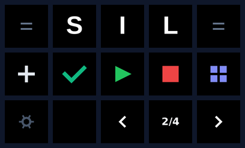
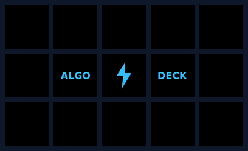

# AlgoDeck ⚡ (Koło MAP)

<p align="center">
  
</p>

<p align="center">
  <strong>Błyskawiczne środowisko olimpijskie C++20 dla zawodników Koła MAP, Szkopuła, OIJ i Olimpiady Informatycznej.</strong><br>
  <em>Pobierasz zadanie z przeglądarki &rarr; <strong>1 kliknięcie</strong> &rarr; kodujesz w Visual Studio Code z automatycznymi testami i bezpośrednim sterowaniem fizycznym Stream Deckiem.</em>
</p>

<p align="center">
  
  
  
  
  
</p>

---

## ⚡ Błyskawiczna Instalacja (One-Liner)

Wklej jedno polecenie w terminalu swojego systemu, aby zainstalować całe środowisko. Instalator automatycznie skonfiguruje kompilator C++20, zbuduje i zarejestruje demona systemowego w tle, skopiuje ścieżkę rozszerzenia do schowka i otworzy stronę przeglądarki:

### 🐧 Linux (Ubuntu, Debian, Fedora, Arch)
```bash
curl -fsSL https://raw.githubusercontent.com/veritus-git/AlgoDeck/main/install.sh | bash
```

### 🍎 macOS (Apple Silicon M1/M2/M3/M4 & Intel)
```bash
curl -fsSL https://raw.githubusercontent.com/veritus-git/AlgoDeck/main/install_mac.sh | bash
```

### 🪟 Windows 10 / 11 (PowerShell)
```powershell
irm https://raw.githubusercontent.com/veritus-git/AlgoDeck/main/install_win.ps1 | iex
```
> *Alternatywnie w oknie Uruchom (Win+R):*  
> `powershell -ExecutionPolicy Bypass -Command "irm https://raw.githubusercontent.com/veritus-git/AlgoDeck/main/install_win.ps1 | iex"`

---

## 📸 Jak to działa w praktyce? (Workflow Olimpijczyka)

### 1. Pobierasz zadanie z platformy konkursowej ➔ 1-Kliknięcie
Gdy na Szkopule, OIJ, SIO2 czy Olimpiadzie Informatycznej klikniesz **Pobierz treść zadania (.pdf)**, AlgoDeck natychmiast przechwytuje plik i wyświetla ultra-kompaktowe okienko:

<p align="center">
  
</p>

- **Automatyczne parsowanie:** Silnik w Rust odczytuje kod zadania, tytuł, limity czasu wykonania (np. `1.0s`) i pamięci (np. `128 MB`), a także przykładowe testy z treści zadania.
- **Jedno kliknięcie:** Klikasz **`⚡ Utwórz Workspace i Otwórz VS Code`** i od razu możesz pisać rozwiązanie.
- **Kolejkowanie w tle:** Jeśli zamkniesz okienko `✕`, zadanie nie przepada – czeka bezpiecznie na pasku rozszerzenia z zieloną odznaką `1`.

---

### 2. Gotowy Workspace z Dzielonym Widokiem w Visual Studio Code
AlgoDeck błyskawicznie przygotowuje ustrukturyzowany folder zadania i wyciąga okno VS Code na pierwszy plan:

```
AlgoDeckWorkspace/
└── koleje/
    ├── code.cpp           # Gotowy kod C++20 z szablonem olimpijskim (fast I/O)
    ├── zadanie.pdf        # Oficjalna treść zadania otwarta obok kodu
    ├── testy/             # Pobrane lub wyodrębnione testy wzorcowe (.in / .out)
    │   ├── kol1.in
    │   ├── kol1.out
    │   ├── kol2.in
    │   └── kol2.out
    ├── run.sh             # Skrypt błyskawicznego kompilowania i testowania
    └── run_interactive.sh # Skrypt uruchamiania z ręcznym wprowadzaniem cin/cout
```

- **Podzielony ekran (Split View):** Treść zadania `.pdf` wyświetla się w dedykowanej kolumnie tuż obok Twojego kodu `code.cpp`.
- **Pełna konfiguracja VS Code:** Wygenerowane `tasks.json` i `launch.json` pozwalają na uruchamianie testów również skrótem `Ctrl+Shift+B` lub `F5`.

---

### 3. Bezpośrednie Sterowanie Stream Deckiem (Hardware USB)
AlgoDeck posiada wbudowany sterownik USB HID w Rust – łączy się bezpośrednio z kablem Stream Decka (15 klawiszy), bez konieczności instalowania oprogramowania Elgato ani zewnętrznych aplikacji:

<p align="center">
  
</p>

| Klawisz | Ikona / Opis | Działanie w AlgoDeck |
|:---:|:---:|:---|
| **0..4** | **`[ = ] [ S ] [ I ] [ L ] [ = ]`** | 5-klawiszowy identyfikator zadania. Kliknięcie natychmiast skupia plik w VS Code |
| **5** | **`+`** | Otwiera stronę importu nowego zadania (PDF / ZIP) w przeglądarce |
| **6** | **`✓`** | **Kompiluj i przetestuj:** Uruchamia wszystkie testy, kafelki dynamicznie raportują wynik (zielony checkmark, czerwony krzyżyk z czasem w ms, ostrzeżenie TLE) |
| **7** | **`▶`** | **Uruchom interaktywnie:** Kompiluje i odpala program w terminalu VS Code z obsługą klawiatury |
| **8** | **`⏹`** | **Zatrzymaj:** Natychmiast zabija działające procesy w nieskończonej pętli (SIGKILL / taskkill) |
| **9** | **`⊞`** | **Galeria zadań:** Przełącza Stream Deck w widok kafelków wszystkich zadań w workspace |
| **10** | **`⚙`** | **Ustawienia:** Błyskawicznie otwiera Centrum Konfiguracji pod `http://127.0.0.1:8080/settings` |
| **11** | *(Pusty)* | Wygaszony klawisz (czysta czerń OLED) |
| **12** | **`‹`** | Przejdź do poprzedniego zadania w workspace |
| **13** | **`2 / 4`** | Wskaźnik numeru aktualnego zadania i łącznej liczby zadań |
| **14** | **`›`** | Przejdź do kolejnego zadania w workspace |

#### Ekran czuwania (Idle Screen):
Gdy nie pracujesz nad żadnym zadaniem, Stream Deck wita Cię minimalistycznym, ciemnym ekranem:

<p align="center">
  
</p>

---

### 4. Panel AlgoDeck Workspace Hub (`http://127.0.0.1:8080/`)
Jeśli wolisz korzystać z przeglądarki, pełny panel pozwala na zarządzanie zadaniami metodą przeciągnij-i-upuść lub ręczne tworzenie zadań:

<p align="center">
  
</p>

- **Strefa PDF / ZIP:** Upuść treść zadania oraz opcjonalne archiwum `.zip` z testami ze Szkopuła.
- **Ręczny kreator zadań:** Przydatny na zajęciach Koła MAP, gdy treść zadania lub przykłady wejścia/wyjścia są dyktowane na tablicy.
- **Lista i szybkie przełączanie:** Podgląd wszystkich zadań w Twoim workspace wraz z możliwością ich natychmiastowej aktywacji.

---

### 5. Centrum Konfiguracji i Architektury (`/settings`)
Dostosuj zachowanie środowiska do własnych preferencji:

<p align="center">
  
</p>

- **Ścieżka Workspace:** Domyślnie `~/AlgoDeckWorkspace` (lub `C:\AlgoDeckWorkspace` na Windowsie).
- **Pozycja i proporcje podziału:** Wybierz, czy treść PDF ma być po lewej, czy prawej stronie kodu oraz ustaw dokładny suwak proporcji (np. 60% kod / 40% treść).
- **Kompilator i flagi C++:** Wybór pomiędzy `g++`, `clang++` a `cl.exe`, włączanie sanitizerów (`AddressSanitizer`, `UndefinedBehaviorSanitizer`) oraz regulacja limitów czasu.
- **Jasność Stream Decka:** Płynna regulacja podświetlenia sprzętu z podglądem na żywo.
- **Pamięć pobrań (Fresh Session Guard):** Dedykowany przycisk resetu bazy zarejestrowanych plików z licznikiem na żywo, zapobiegający ponownemu spamowaniu pobraniami z historii.

---

## 🧩 Aktywacja Rozszerzenia w Przeglądarce

1. Otwórz w przeglądarce stronę rozszerzeń:
   - **Google Chrome:** `chrome://extensions`
   - **Brave Browser:** `brave://extensions`
   - **Microsoft Edge:** `edge://extensions`
2. Włącz przełącznik **Tryb programisty** (Developer mode) w prawym górnym rogu.
3. Kliknij **Załaduj rozpakowane** (Load unpacked) i wybierz katalog `extension`:
   - **Linux / macOS:** `~/.local/share/algodeck/extension` *(ścieżka znajduje się w Twoim schowku po instalacji!)*
   - **Windows:** `%LOCALAPPDATA%\AlgoDeck\extension`
4. Przypnij ikonę ⚡ **AlgoDeck** do paska narzędzi przeglądarki.

---

## 💻 Przydatne Polecenia CLI

Silnik AlgoDeck działa w tle jako usługa systemowa (`systemd` na Linuksie, `launchd` na macOS, usługa tła na Windowsie). Możesz nim wygodnie zarządzać z dowolnego terminala:

```bash
# Sprawdź stan serwera, liczbę zadań i status USB Stream Decka
algodeck status

# Skompiluj i odpal testy konkretnego zadania w konsoli
algodeck test sil

# Uruchom rozwiązanie w interaktywnym trybie konsolowym
algodeck run sil

# Otwórz Centrum Ustawień w domyślnej przeglądarce
algodeck settings

# Bezpiecznie zatrzymaj demona AlgoDeck
algodeck stop

# Uruchom demona ręcznie
algodeck start
```

---

## 🛡️ Architektura Techniczna

- **Silnik (Engine):** 100% Rust – zero narzutu pamięciowego, asynchroniczny serwer Axum, natywny sterownik USB HID przez `hidapi`.
- **Mostek Edytora (Bridge):** Komunikacja z VS Code przez lokalne gniazda UNIX / Named Pipes – natychmiastowe otwieranie plików i podziału okien bez opóźnień.
- **Interfejs (Frontend):** Czysty Vanilla JS & CSS – zero ciężkich bibliotek, glassmorficzny dark mode, zoptymalizowany pod kątem responsywności.
- **Zarządzanie Oknami:** Natywna obsługa wyciągania okien na pierwszy plan pod GNOME, Cinnamon, KDE Plasma, X11, macOS i Windows.

---

<p align="center">
  Tworzone z pasją dla uczestników <strong>Koła MAP</strong> oraz pasjonatów algorytmiki olimpijskiej ⚡
</p>
