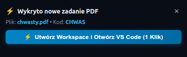
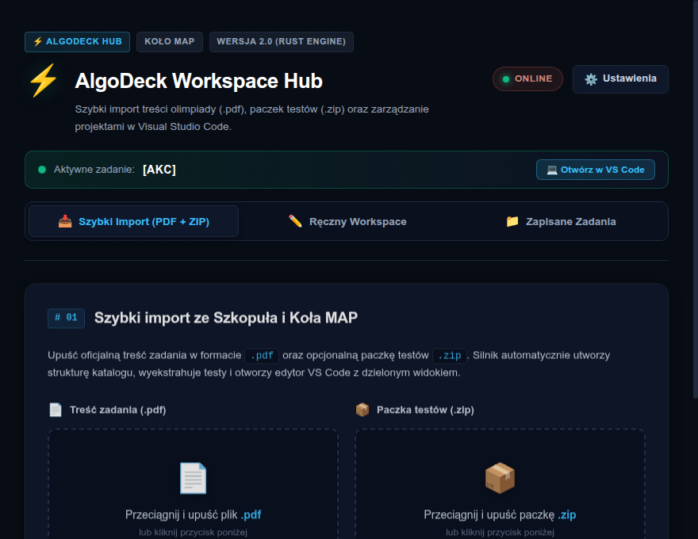
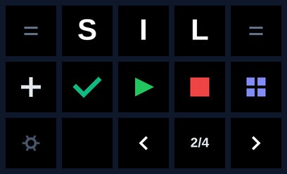
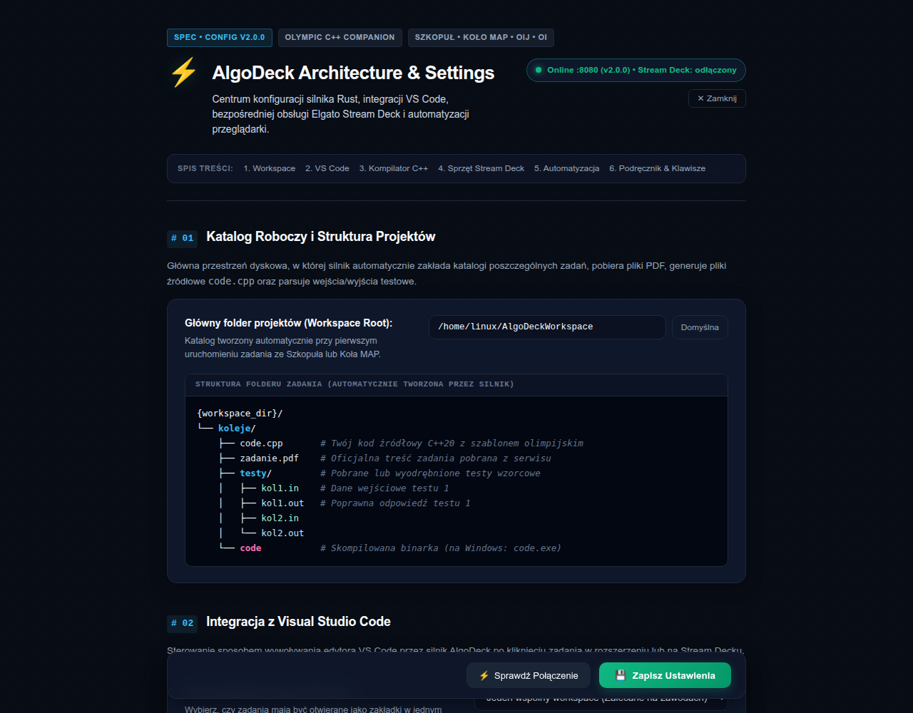

# AlgoDeck ⚡ (Koło MAP)

> **Błyskawiczne środowisko do zadań olimpijskich C++ dla Koła MAP, Szkopuła, OIJ i OI.**  
> Pobierasz zadanie z przeglądarki &rarr; **1 kliknięcie** &rarr; kodujesz w Visual Studio Code z testami i bezpośrednią obsługą Stream Decka.

---

## ⚡ Instalacja One-Liner (Główna metoda)

Wklej jedno polecenie w terminalu swojego systemu, aby zainstalować całe środowisko (silnik Rust, kompilator C++20, mostek przeglądarki, demona w tle i rozszerzenie):

### 🐧 Linux (Ubuntu, Debian, Fedora, Arch)
```bash
curl -fsSL https://raw.githubusercontent.com/veritus-git/AlgoDeck/main/install.sh | bash
```

### 🍎 macOS (Apple Silicon M1/M2/M3/M4 & Intel)
```bash
curl -fsSL https://raw.githubusercontent.com/veritus-git/AlgoDeck/main/install_mac.sh | bash
```

### 🪟 Windows 10 / 11 (PowerShell)
```powershell
irm https://raw.githubusercontent.com/veritus-git/AlgoDeck/main/install_win.ps1 | iex
```
> *Alternatywnie w CMD / oknie Uruchom (Win+R):*  
> `powershell -ExecutionPolicy Bypass -Command "irm https://raw.githubusercontent.com/veritus-git/AlgoDeck/main/install_win.ps1 | iex"`

---

## 📸 Jak to wygląda w akcji

### 1. Błyskawiczne wykrycie i 1-Kliknięcie (Pobranie ➔ Gotowy Workspace)
Pobierasz treść zadania (`.pdf`) ze Szkopuła, OIJ czy SIO2 — AlgoDeck natychmiast wyświetla kompaktowe okienko powiadomienia. Jedno kliknięcie zakłada workspace, parsuje limity pamięci/czasu i otwiera VS Code z podziałem ekranu (treść + kod C++). W razie zamknięcia okienka zadanie automatycznie czeka w kolejce na pasku rozszerzenia.

<p align="center">
  
</p>


### 2. Panel AlgoDeck Workspace Hub (`http://127.0.0.1:8080/`)
Zarządzaj swoimi zadaniami, dodawaj pliki metodą przeciągnij-i-upuść lub twórz własne szablony z niestandardowymi danymi wejściowymi.

<p align="center">
  
</p>

### 3. Bezpośrednie sterowanie Stream Deckiem (Hardware USB)
Działa bezpośrednio z magistralą USB urządzenia — bez oficjalnej aplikacji Elgato czy StreamControllera.

<p align="center">
  
</p>

| Klawisz | Działanie |
|:---:|:---|
| **`●` (0..4, 11..13)** | Dynamiczne wskaźniki statusu poszczególnych testów |
| **`KOD` (2)** | Identyfikator aktualnego zadania (np. `CHW`, `SIL`) |
| **`</>` (5)** | Otwórz w VS Code z podziałem ekranu (kod C++ + treść PDF) |
| **`⚗` (6)** | Skompiluj z flagami olimpijskimi i uruchom wszystkie testy |
| **`▶` (7)** | Uruchom program w interaktywnym terminalu |
| **`⏹` (8)** | Natychmiast zatrzymaj zapętlony kod bez zamykania VS Code |
| **`⚙` (9)** | Ustawienia jasności i konfiguracji |
| **`‹` / `›` (10, 14)** | Szybkie przełączanie między zadaniami |

### 4. Centrum Konfiguracji i Ustawień
Pełna kontrola nad stroną podziału okien (VS Code po lewej lub prawej), proporcjami ekranu, katalogiem roboczym oraz kompilatorem C++20.

<p align="center">
  
</p>

---

## 🧩 Aktywacja Rozszerzenia w Przeglądarce

1. Wejdź pod adres `chrome://extensions` (lub `brave://extensions` / `edge://extensions`).
2. Włącz w prawym górnym rogu przełącznik **Tryb programisty** (Developer mode).
3. Kliknij **Załaduj rozpakowane** (Load unpacked) i wybierz folder `extension`:
   - **Linux / macOS:** `~/.local/share/algodeck/extension`
   - **Windows:** `%LOCALAPPDATA%\AlgoDeck\extension`
4. Przypnij ikonę ⚡ **AlgoDeck** do paska narzędzi. Gotowe!

---

## 💻 Przydatne polecenia CLI

Silnik AlgoDeck działa w tle jako cichy demon. Możesz nim również sterować z terminala:

```bash
algodeck status          # Sprawdź stan serwera i połączenie ze Stream Deckiem
algodeck test <kod>      # Odpal testy danego zadania w konsoli
algodeck run <kod>       # Uruchom interaktywnie rozwiązanie
algodeck stop            # Bezpiecznie zatrzymaj daemona
```
